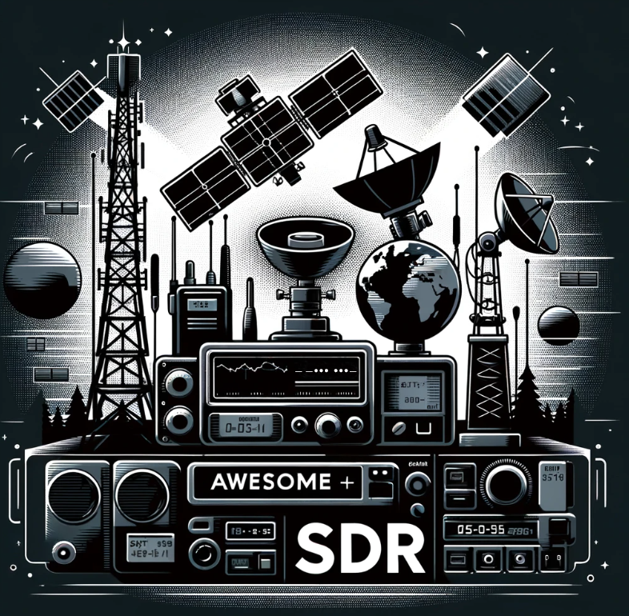

# Awesome Software Defined Radio (SDR)

> A curated, practitioner-level repository covering Software Defined Radio, amateur radio, satellite tracking, RF security research, and signal intelligence. Built for engineers, security researchers, and RF enthusiasts.



---

## Table of Contents

- [Getting Started](#getting-started)
- [General Purpose SDR Software](#general-purpose-sdr-software)
- [Satellite Applications](#satellite-applications)
- [Spectrum Analyzers](#spectrum-analyzers)
- [Protocols](#protocols)
  - [GSM / 4G / 5G](#gsm--4g--5g)
  - [Bluetooth Low Energy (BLE)](#bluetooth-low-energy-ble)
  - [AIS](#ais-automatic-identification-system)
  - [APRS](#aprs-automatic-packet-reporting-system)
  - [SSTV](#sstv-slow-scan-television)
  - [DMR](#dmr-digital-mobile-radio)
  - [ACARS](#acars-aircraft-communications-addressing-and-reporting-system)
  - [Radiosonde](#radiosonde--weather-balloon-tracking)
  - [LoRa / LoRaWAN](#lora--lorawan)
  - [POCSAG / FLEX](#pocsag--flex-paging-systems)
  - [Iridium / Inmarsat](#iridium--inmarsat)
  - [DAB / DAB+](#dab--dab-digital-audio-broadcasting)
  - [TETRA](#tetra-terrestrial-trunked-radio)
  - [RTTY / PSK31 / Olivia](#rtty--psk31--olivia-hf-digital-modes)
  - [M17](#m17)
  - [EAS](#eas-emergency-alert-system)
- [Weather Satellites](#weather-satellites)
- [Aviation](#aviation)
  - [ADS-B](#ads-b)
  - [VOR](#vor)
  - [ILS](#ils-instrument-landing-system)
  - [DME](#dme-distance-measuring-equipment)
- [Amateur Radio Digital Modes](#amateur-radio-digital-modes)
  - [FT8 / JS8Call / Winlink](#ft8--js8call--winlink)
  - [D-STAR / System Fusion / P25](#d-star--system-fusion--p25)
- [RF Security Research](#rf-security-research)
  - [Automotive RF](#1-automotive-rf)
  - [IoT / ISM Band](#2-iot--ism-band-devices)
  - [Paging Systems](#3-paging-systems-pocsagflex)
  - [Trunked Radio](#4-trunked-radio-systems)
  - [GNSS Spoofing & Jamming](#5-gnss-spoofing--jamming)
  - [RF Fingerprinting](#6-rf-fingerprinting)
  - [SIGINT Fundamentals](#7-signal-intelligence-sigint-fundamentals)
  - [Drone Detection & C-UAS](#8-drone-detection--counter-uas)
  - [TEMPEST / Van Eck Phreaking](#9-tempest--van-eck-phreaking)
  - [RFID / Proxcard](#10-rfid--proxcard)
  - [Zigbee / Z-Wave](#11-zigbee--z-wave)
  - [IMSI Catchers](#12-imsi-catchers)
  - [RF CTF Resources](#13-rf-ctf-resources)
- [Hardware](#hardware)
  - [SDR Device Comparison](#sdr-device-comparison)
  - [Antennas](#antennas)
  - [LNA / Filters / Accessories](#lna--filters--accessories)
  - [PortaPack Mayhem](#portapack-mayhem)
- [Resources & Community](#resources--community)

---

## Getting Started

### What is SDR and Why Should You Care?

Software Defined Radio replaces purpose-built hardware components (mixers, filters, amplifiers, modulators/demodulators) with generic hardware and software signal processing. The RF front-end captures raw IQ (In-phase/Quadrature) samples; everything else happens in software. This opens up a remarkably wide surface area — from passive listening to active protocol analysis and security research.

### Hardware Entry Points

| Device | Best For |
|--------|----------|
| RTL-SDR Blog V4 | RX-only, learning, ADS-B, FM, AIS |
| Airspy HF+ Discovery | High dynamic range HF/VHF reception |
| HackRF One | TX+RX, security research, protocol fuzzing |
| LimeSDR Mini 2.0 | Full-duplex, 5G/LTE experimentation |
| Ettus B210 | Research-grade, MIMO, GNU Radio workflows |

> **First build recommendation:** RTL-SDR Blog V4 + SDR++ on Linux. Plug in, open SDR++, tune to 1090 MHz — within minutes you'll be receiving live aircraft transponder data. No license required for RX-only.

### Essential First Projects (Ordered by Complexity)

1. **FM broadcast reception** — validates hardware, zero configuration
2. **ADS-B aircraft tracking** — `dump1090` + `tar1090`, immediate visual payoff
3. **Weather satellite imagery** — NOAA APT at 137 MHz, 20-min setup
4. **AIS vessel tracking** — passive maritime intelligence on 161.975/162.025 MHz
5. **APRS packet decoding** — 144.39 MHz (NA) / 144.80 MHz (EU)
6. **Trunked radio decoding** — `sdrtrunk`, real operational complexity
7. **GSM passive monitoring** — `gr-gsm` + Wireshark, entry-level cellular security

### Recommended Reading Before You Start

- [RTL-SDR Quick Start Guide](https://www.rtl-sdr.com/rtl-sdr-quick-start-guide/) — validated, up-to-date, hardware-agnostic
- [The Hobbyist's Guide to the RTL-SDR](https://www.amazon.com/gp/product/B00KCDF1QI/) — structured curriculum, highly practical
- [GNU Radio Tutorials](https://wiki.gnuradio.org/index.php/Tutorials) — mandatory if you plan to build custom signal processing pipelines
- [PySDR: A Guide to SDR and DSP using Python](https://pysdr.org/) — modern, Pythonic, excellent for security engineers

---

## General Purpose SDR Software

### [SDRAngel](https://www.sdrangel.org/)
Open-source TX & RX SDR platform with a plugin-based architecture. Supports demodulation of dozens of protocols natively including AIS, ADS-B, APRS, DMR, D-Star, and more — all within a single UI.

- **Blog/Project:** [SDRAngel as a Complete Ham Radio Station](https://www.sdrangel.org/2021/10/31/sdrangel-as-a-complete-ham-radio-station/)
- **Security angle:** Plugin architecture allows integration with custom demodulators. Useful for building monitoring pipelines for proprietary or unknown protocols.
- **Supported hardware:** RTL-SDR, HackRF, LimeSDR, PlutoSDR, USRP, Airspy, SDRplay

---

### [GNU Radio](https://www.gnuradio.org/)
The industry-standard signal processing framework. Flowgraph-based DSP: nodes are processing blocks (filters, FFTs, demodulators), edges are data streams. The foundational layer that most serious SDR work runs on.

- **Blog/Project:** [GNU Radio Tutorials — From Zero to Flowgraph](https://wiki.gnuradio.org/index.php/Tutorials)
- **Blog/Project:** [Building a Real-Time ADS-B Decoder in GNU Radio](https://www.rtl-sdr.com/building-a-simple-adsb-receiver-in-gnuradio/)
- **Blog/Project:** [gr-gsm: Passive GSM Monitoring with GNU Radio](https://github.com/ptrkrysik/gr-gsm)
- **Security angle:** Ideal for protocol reverse engineering. Build custom flowgraphs that capture, filter, and log arbitrary RF protocols for offline analysis.
- **Key packages:** `gr-osmosdr`, `gr-ais`, `gr-gsm`, `gr-ieee802154`, `gr-lora`

---

### [SDR# (SDRSharp)](https://airspy.com/download/)
The de facto standard for Windows-based SDR. Exceptional UI polish, large plugin ecosystem, near-zero configuration.

- **Blog/Project:** [SDR# Plugin Development Guide](https://www.rtl-sdr.com/sdrsharp-plugins/)
- **Blog/Project:** [Receiving NOAA Weather Satellites with SDR#](https://www.rtl-sdr.com/rtl-sdr-tutorial-receiving-noaa-weather-satellite-images/)

---

### [Gqrx SDR](https://www.gqrx.dk/)
GNU Radio-backed, Qt-fronted SDR receiver. Preferred Linux/macOS monitoring option.

- **Blog/Project:** [Gqrx + RTL-SDR on Raspberry Pi](https://gqrx.dk/doc/running-gqrx-on-the-raspberry-pi)
- **Blog/Project:** [Decoding POCSAG Pager Traffic with Gqrx + multimon-ng](https://www.rtl-sdr.com/rtl-sdr-tutorial-pocsag-pager-decoding/)

---

### [SDR++](https://github.com/AlexandreRouma/SDRPlusPlus)
Cross-platform, modular, minimal. C++ for performance. Best for headless deployments and always-on monitoring nodes.

- **Blog/Project:** [SDR++ Module Development](https://github.com/AlexandreRouma/SDRPlusPlus/blob/master/docs/module_dev.md)

---

### [CubicSDR](https://cubicsdr.com/)
Cross-platform, visually focused. Excellent waterfall rendering, frequency bookmarking.

---

### [HDSDR](https://www.hdsdr.de/)
Windows-only, ExtIO plugin system. Reliable for legacy setups.

---

### [ShinySDR](https://github.com/kpreid/shinysdr)
Web-based SDR interface backed by GNU Radio. Access from any browser on the network.

---

### [GNSS-SDR](https://github.com/gnss-sdr/gnss-sdr)
Full GPS/GNSS receiver chain in software. Research-grade, used in spoofing detection.

- **Blog/Project:** [GPS Spoofing Detection with GNSS-SDR](https://gnss-sdr.org/docs/tutorials/gnss-sdr-operation-real-time/)
- **Security angle:** Enables building spoofing/meaconing detection systems by analyzing raw receiver internals.

---

### [sdrtrunk](https://github.com/DSheirer/sdrtrunk)
Java-based trunked radio decoder. P25, DMR, MotoTRBO, EDACS, LTR.

- **Blog/Project:** [Decoding a P25 Trunked System with sdrtrunk](https://www.radioreference.com/db/browse/)
- **Getting started:** Identify local trunked systems via [RadioReference DB](https://www.radioreference.com/), configure site frequencies, let sdrtrunk auto-decode control channels.

---

### [LocalRadio](https://github.com/dsward2/LocalRadio)
macOS-native SDR app with iOS remote streaming. GPL-2. Casual listening experience.

---

### [OpenWebRX](https://www.openwebrx.de/)
Web-based multi-user SDR receiver. Runs as a server — users connect via browser, each with independent frequency/bandwidth control. Supports RTL-SDR, HackRF, SDRplay, PlutoSDR, LimeSDR, and more. Includes built-in decoders for FT8, WSPR, APRS, AIS, DMR, POCSAG, and others.

- **Blog/Project:** [Setting Up OpenWebRX for Remote SDR Access](https://www.rtl-sdr.com/openwebrx-a-new-open-source-multi-user-sdr-receiver/)
- **Blog/Project:** [OpenWebRX+ Feature Overview](https://github.com/jketterl/openwebrx)
- **Best use case:** Always-on monitoring station accessible from any device. Excellent for shared lab environments or remote site monitoring.
- [OpenWebRX Public Receivers](https://www.receiverbook.de/) — Map of publicly accessible OpenWebRX instances worldwide

---

## Satellite Applications

### [SatDump](https://github.com/SatDump/SatDump)
Gold standard for satellite signal processing. Decodes NOAA, Meteor-M, Electro-L, FengYun — demodulation through image compositing in one pipeline.

- **Blog/Project:** [Receiving Meteor-M2 LRPT Images with SatDump](https://www.rtl-sdr.com/receiving-meteor-m2-lrpt-images-with-satdump/)
- **Blog/Project:** [Decoding GOES-16 Full Disk Images via SatDump](https://www.rtl-sdr.com/decoding-goes-16-full-disk-images/)

---

### [goestools](https://github.com/pietern/goestools)
GOES East/West geostationary weather satellite reception. Full-disk Earth imagery updated every 10–15 minutes.

- **Blog/Project:** [Setting Up a GOES-16 Ground Station](https://www.rtl-sdr.com/rtl-sdr-com-goes-16-17-and-gk-2a-weather-satellite-reception-comprehensive-tutorial/)

---

### [Gpredict](https://oz9aec.dk/gpredict/)
Real-time satellite tracking with pass prediction. Integrates with rotator controllers.

- **Getting started:** Import TLE from [Celestrak](https://celestrak.org/), add ground station coordinates, use polar plot for upcoming passes.

---

## Spectrum Analyzers

### [Universal Radio Hacker (URH)](https://github.com/jopohl/urh)
The most important tool for RF security research. Capture → visualize → demodulate → decode → analyze → fuzz. Automatic modulation parameter detection.

- **Blog/Project:** [Reverse Engineering a 433 MHz Remote Control with URH](https://github.com/jopohl/urh/wiki/How-to-reverse-engineer-a-simple-RF-protocol)
- **Blog/Project:** [Analyzing TPMS with URH](https://www.rtl-sdr.com/rtl-sdr-tutorial-decoding-tpms-tire-pressure-monitor-sensors/)
- **Getting started:** Capture → URH auto-detects modulation → compare multiple captures → identify preamble, sync, payload, checksum.

---

### [Inspectrum](https://github.com/miek/inspectrum)
Purpose-built IQ file analysis. Superior time/frequency visualization.

- **Blog/Project:** [Analyzing an Unknown FSK Signal with Inspectrum](https://miek.nl/2016/july/09/inspectrum/)

---

### [SigDigger](https://github.com/BatchDrake/SigDigger)
Real-time digital signal analyzer. FSK, PSK, ASK demodulation. Cyclostationary analysis for burst transmissions.

- **Blog/Project:** [SigDigger for Unknown Signal Analysis](https://batchdrake.github.io/sigdigger/)

---

## Protocols

---

### GSM / 4G / 5G

| Standard | Generation | Core Technology | Max Throughput | Security |
|----------|-----------|-----------------|----------------|----------|
| GSM | 2G | TDMA | 114 kbps | A5/1 (broken since 2009) |
| UMTS | 3G | WCDMA | 42 Mbps | KASUMI (weaknesses known) |
| LTE | 4G | OFDMA | 1 Gbps | AES-based |
| NR | 5G | OFDM + mmWave | 20 Gbps | AES + SUPI concealment |

**GSM Tools:**
- [gr-gsm](https://github.com/ptrkrysik/gr-gsm) — GSM baseband decoder → Wireshark via `grgsm_livemon`
- [Kalibrate-RTL](https://github.com/steve-m/kalibrate-rtl) — Oscillator calibration using GSM base stations
- [YateBTS](https://yatebts.com/open_source/) — Open source GSM Base Station for research environments
- **Blog/Project:** [Passive GSM Monitoring with gr-gsm and Wireshark](https://www.rtl-sdr.com/rtl-sdr-tutorial-analyzing-gsm-with-airprobe-and-wireshark/)

**4G / LTE Tools:**
- [srsRAN 4G](https://github.com/srsran/srsRAN_4G) — Complete open-source LTE stack: UE, eNB, EPC
- **Blog/Project:** [Building a Private LTE Network with srsRAN](https://docs.srsran.com/projects/4g/en/latest/tutorials/source/srsUE/source/index.html)

**5G Tools:**
- [Open5GS](https://open5gs.org/) — 5G Core + EPC in C
- **Blog/Project:** [Private 5G Network with Open5GS + srsRAN](https://open5gs.org/open5gs/docs/guide/01-quickstart/)

---

### Bluetooth Low Energy (BLE)

- **PHY:** 2.4 GHz ISM, 40 channels, advertising on ch. 37/38/39
- **Modulation:** GFSK
- **Security posture:** AES-CCM for encrypted connections, but advertising packets are unencrypted by default

**Tools:**
- [BTLE](https://github.com/JiaoXianjun/BTLE) — GNU Radio BLE TX/RX. Generates arbitrary advertising packets.
- [btlejack](https://github.com/virtualabs/btlejack) — BLE sniffing, jamming, hijacking (BBC micro:bit or Ubertooth)
  - **Blog/Project:** [BLE Connection Hijacking with btlejack](https://github.com/virtualabs/btlejack/blob/master/doc/bluetooth_low_energy_hacking.md)
- [Wall-of-Flippers](https://github.com/K3YOMI/Wall-of-Flippers) — Detects Flipper Zero and BLE-based attacks
- [Ubertooth One](https://greatscottgadgets.com/ubertoothone/) — Dedicated Bluetooth research platform
  - **Blog/Project:** [Sniffing BLE with Ubertooth + Wireshark](https://ubertooth.readthedocs.io/en/latest/ubertooth_one.html)
- [RxAndroidBle](https://github.com/dariuszseweryn/RxAndroidBle) — Android BLE library with RxJava3

**Blog/Project:** [BLE Security Testing Methodology](https://www.nccgroup.com/us/research-blog/technical-advisory-bluetooth-le-ble-security-overview/)

---

### AIS (Automatic Identification System)

- **Frequencies:** 161.975 MHz (Ch. 87B) + 162.025 MHz (Ch. 88B) — monitor both simultaneously
- **Modulation:** GMSK, 9600 baud
- **Security posture:** No authentication. Self-reported GPS. Trivially spoofable — documented in Black Sea/Persian Gulf incidents.

**Tools:**
- [AIS-catcher](https://github.com/jvde-github/AIS-catcher) — Best-in-class decoder. Dual-channel, NMEA output.
  - **Getting started:** `ais-catcher -d 0 -u 127.0.0.1 10110`
  - **Blog/Project:** [Setting Up AIS-catcher with OpenCPN](https://www.rtl-sdr.com/ais-catcher-a-multi-platform-ais-receiver/)
- [OpenCPN](https://opencpn.org/) — Open-source chart plotter for AIS visualization
- [SDRAngel AIS Plugin](https://github.com/f4exb/sdrangel/blob/master/plugins/feature/ais/readme.md)
- [ShipXplorer](https://www.shipxplorer.com/) — Live commercial vessel tracker

**Blog/Project:** [AIS Spoofing and Maritime Cybersecurity](https://www.c4isrnet.com/electronic-warfare/2019/06/10/ais-spoofing-threat/)

---

### APRS (Automatic Packet Reporting System)

- **Frequencies:** 144.390 MHz (NA), 144.800 MHz (EU)
- **Modulation:** Bell 202 AFSK, 1200 baud on FM
- **Network:** Digipeaters (RF relay) → iGates (RF→Internet) → APRS-IS backbone

**Tools:**
- [Direwolf](https://github.com/wb2osz/direwolf) — Software TNC, iGate/digipeater capable
  - **Getting started:** `rtl_fm -f 144.39M -s 22050 | direwolf -r 22050 -`
- [LoRa APRS Tracker](https://github.com/lora-aprs/LoRa_APRS_Tracker) — ESP32 + LoRa tracker
- [LoRa_APRS_iGate](https://github.com/lora-aprs/LoRa_APRS_iGate) — ESP32 LoRa iGate
- [SDRAngel APRS Plugin](https://github.com/f4exb/sdrangel/tree/master/plugins/feature/aprs)
- [aprs.fi](https://aprs.fi) — Live global APRS map

**Blog/Project:** [Build an APRS iGate with RTL-SDR in 30 Minutes](https://www.instructables.com/Build-an-Amateur-Radio-APRS-RX-Only-IGate-Using-a/)
**Blog/Project:** [Raspberry Pi APRS Tracker/Digipeater/iGate](https://vk3il.net/projects/raspberry-pi-based-aprs-trackerdigipeaterigate/)

---

### SSTV (Slow Scan Television)

- **Frequencies:** 14.230 MHz (HF/USB), 145.800 MHz (ISS events)
- **Modes:** Martin M1/M2, Scottie S1/S2, Robot 36/72

**Tools:**
- [QSSTV](https://github.com/ON4QZ/QSSTV) — Linux SSTV TX/RX, analog + digital DRM
- [Robot36](https://github.com/xdsopl/robot36) — Lightweight SSTV decoder

**Blog/Project:** [Receiving SSTV Images from the ISS](https://www.rtl-sdr.com/international-space-station-sstv-event-scheduled-for-october-9-and-10/)
**Blog/Project:** [Receiving SSTV with RTL-SDR](https://emar10.dev/posts/rtl-sdr-sstv/)
**Blog/Project:** [ARISS SSTV Gallery](https://www.spaceflightsoftware.com/ARISS_SSTV/index.php) — Archive of ISS-received images from stations worldwide

---

### DMR (Digital Mobile Radio)

- **Standard:** ETSI TS 102 361, 12.5 kHz, 4FSK, 4800 baud
- **Capacity:** 2 timeslots/channel via TDMA
- **Encryption:** AES-256 (optional) or Basic Encryption (40-bit, breakable)

**Tools:**
- [sdrtrunk](https://github.com/DSheirer/sdrtrunk) — DMR Tier II/III trunked decoding
- [DSD](https://github.com/szechyjs/dsd) — DMR, P25, D-STAR, NXDN audio decode
- [DSD+](https://www.dsdplus.com/) — Windows DSD fork, better decode rates
- [SDRAngel DMR Plugin](https://github.com/f4exb/sdrangel/blob/master/plugins/channelrx/demoddmr/readme.md)

**Blog/Project:** [Decoding DMR with RTL-SDR and DSD+](https://www.rtl-sdr.com/rtl-sdr-radio-scanner-tutorial-decoding-digital-speech-p25-mototrbo/)
**Security note:** DMR Basic Encryption (40-bit) is widely deployed and widely broken. Many operators believe they have encrypted communications when they do not.

---

### ACARS (Aircraft Communications Addressing and Reporting System)

- **Frequencies:** 129.125, 130.025, 130.450, 131.125, 131.550 MHz (VHF, region-dependent)
- **Modulation:** AM-MSK (2400 baud VHF), HFDL (HF variant), VDL Mode 2 (digital successor)
- **Content:** Flight plans, weather, ATIS, engine telemetry, crew messages — all in cleartext
- **Security posture:** No encryption, no authentication. Historically has carried partial passenger data and operational schedules.

**Tools:**
- [acarsdec](https://github.com/TLeconte/acarsdec) — Multi-channel ACARS decoder
  - **Getting started:** `acarsdec -r 0 131.550 130.025 130.450`
- [JAERO](https://github.com/jontio/JAERO) — Inmarsat AERO (satellite ACARS) decoder. Receive ACARS without aircraft proximity.
- [dumpvdl2](https://github.com/szpajder/dumpvdl2) — VDL Mode 2 decoder (ACARS successor, still unencrypted)
- [airframes.io](https://app.airframes.io/) — Live ACARS/HFDL/VDL2 aggregator with searchable archive

**Blog/Project:** [Decoding ACARS with RTL-SDR and acarsdec](https://www.rtl-sdr.com/adsb-aircraft-acars-decoder-for-rtl-sdr/)
**Blog/Project:** [Receiving Satellite ACARS with JAERO](https://www.rtl-sdr.com/jaero-a-new-inmarsat-aero-acars-decoder/)
**Blog/Project:** [Decoding VDL Mode 2 with dumpvdl2](https://github.com/szpajder/dumpvdl2)

---

### Radiosonde / Weather Balloon Tracking

- **Frequencies:** 400–406 MHz (primary), 1680 MHz (military variant)
- **Common sondes:** Vaisala RS41 (global standard), RS92 (legacy), Graw DFM, Meteomodem M10/M20
- **Launch schedule:** Twice daily from ~1300 WMO stations worldwide (00:00 + 12:00 UTC)
- **Payload:** GPS position, pressure, temperature, humidity, wind vector — FSK telemetry
- **Recovery:** Burst at 30–35 km, parachute descent. Recoverable and reflashable.

**Tools:**
- [radiosonde_auto_rx](https://github.com/projecthorus/radiosonde_auto_rx) — Automated radiosonde receiver. Auto-detects sonde type, decodes, uploads to SondeHub. Headless Raspberry Pi capable.
  - **Getting started:** `python3 auto_rx.py` — scans 400–406 MHz, identifies and decodes automatically
- [SondeHub](https://sondehub.org/) — Live global tracker with predicted landing points
- [RS](https://github.com/rs1729/RS) — Standalone decoders for obscure sonde types

**Blog/Project:** [Tracking Weather Balloons with RTL-SDR](https://www.rtl-sdr.com/tracking-weather-balloons-with-an-rtl-sdr/)
**Blog/Project:** [Building an Automated Radiosonde Station](https://github.com/projecthorus/radiosonde_auto_rx/wiki)
**Blog/Project:** [Chasing and Recovering Weather Balloons](https://www.rtl-sdr.com/radiosonde-hunting-retrieving-weather-balloons/)

---

### LoRa / LoRaWAN

- **Frequencies:** 868 MHz (EU), 915 MHz (US/AU), 433 MHz (Asia)
- **Modulation:** CSS (Chirp Spread Spectrum) — extremely noise-resistant
- **Parameters:** Spreading Factor SF7–SF12, Bandwidth 125/250/500 kHz
- **Range:** 2–15 km urban, 30–50 km rural LoS
- **Security note:** LoRaWAN 1.0.x has documented vulnerabilities — static DevAddr (trackable), ABP replay attacks, weak nonce handling in OTAA. Many deployed devices still run 1.0.x.

**Tools:**
- [gr-lora](https://github.com/rpp0/gr-lora) — GNU Radio LoRa PHY receiver and decoder
- [gr-lorawan](https://github.com/tmuguet/gr-lorawan) — LoRaWAN MAC decoder for GNU Radio
- [LAF (LoRa Auditing Framework)](https://github.com/IOActive/laf) — LoRaWAN security testing: replay, bit-flip, join procedure attacks
- [ChirpStack](https://www.chirpstack.io/) — Open-source LoRaWAN Network Server for private test networks
- [rtl_433](https://github.com/merbanan/rtl_433) — Decodes 200+ ISM band LoRa-adjacent device types

**Blog/Project:** [LoRa PHY Analysis with gr-lora](https://github.com/rpp0/gr-lora)
**Blog/Project:** [LoRaWAN Security: Attacking Join Procedures](https://labs.ioactive.com/2019/08/laf-lorawan-auditing-framework.html)
**Blog/Project:** [Decoding LoRa with RTL-SDR](https://www.rtl-sdr.com/decoding-lora-with-an-rtl-sdr-and-gr-lora/)

---

### POCSAG / FLEX (Paging Systems)

- **Frequencies:** 138–175 MHz, 450–470 MHz (region-dependent)
- **POCSAG modulation:** FSK, 512/1200/2400 baud
- **Content:** Plaintext numeric or alphanumeric messages. No encryption. No authentication.
- **Users:** Hospitals, emergency services, utilities, industrial facilities

**Tools:**
- [multimon-ng](https://github.com/EliasOenal/multimon-ng) — Decodes POCSAG, FLEX, DTMF, AFSK, EAS
  - **Getting started:** `rtl_fm -f 152.65M -s 22050 | multimon-ng -t raw -a POCSAG512 -a POCSAG1200 -a POCSAG2400 -`
- [PDW](http://www.discriminator.nl/pdw/index-en.html) — Windows POCSAG/FLEX decoder with logging

**Blog/Project:** [Decoding Hospital Pager Messages with RTL-SDR](https://www.rtl-sdr.com/rtl-sdr-tutorial-pocsag-pager-decoding/)
**Security angle:** Healthcare pagers routinely transmit patient names, room numbers, lab results, and care instructions in cleartext. Remains unaddressed in most hospital deployments.

---

### Iridium / Inmarsat

**Iridium:**
- **Frequencies:** 1616–1626.5 MHz (L-band)
- **Constellation:** 66 LEO satellites, true global coverage
- **Note:** Pre-2019 Iridium constellation transmitted unencrypted pager messages. Iridium NEXT encrypts voice/data.

**Inmarsat:**
- **Frequencies:** 1525–1559 MHz (downlink L-band, GEO)
- **Services:** AERO (aviation ACARS), FleetBroadband (maritime), STD-C EGC (safety broadcasts — unencrypted by design)

**Tools:**
- [iridium-toolkit](https://github.com/muccc/iridium-toolkit) — Decodes Iridium burst transmissions
- [gr-iridium](https://github.com/dholm/gr-iridium) — GNU Radio Iridium burst receiver
- [JAERO](https://github.com/jontio/JAERO) — Inmarsat AERO decoder (aircraft satellite ACARS)

**Blog/Project:** [Receiving and Decoding Iridium Satellite Signals](https://www.rtl-sdr.com/decoding-iridium-satellite-signals-with-iridium-toolkit-and-a-rtl-sdr/)
**Blog/Project:** [Tracking Aircraft via Inmarsat AERO with JAERO](https://www.rtl-sdr.com/jaero-a-new-inmarsat-aero-acars-decoder/)
**Blog/Project:** [Iridium Pager Decoding: Historical Analysis (CCC)](https://media.ccc.de/v/camp2011-4429-en-iridium_satellite_hacking)

---

### DAB / DAB+ (Digital Audio Broadcasting)

- **Frequencies:** Band III (174–240 MHz), L-Band (1452–1492 MHz)
- **Modulation:** OFDM, differential QPSK / HE-AAC v2 audio
- **Coverage:** Europe, Australia, Asia. Not deployed in North America.

**Tools:**
- [welle.io](https://www.welle.io/) — Cross-platform DAB/DAB+ receiver with GUI, RTL-SDR native
- [DABlin](https://github.com/Opendigitalradio/DABlin) — Command-line DAB/DAB+ player
- [Qt-DAB](https://github.com/JvanKatwijk/qt-dab) — Feature-rich DAB/DAB+ receiver with spectrum display

**Blog/Project:** [Receiving DAB+ Radio with RTL-SDR and welle.io](https://www.rtl-sdr.com/receiving-dab-digital-audio-broadcasting-with-a-rtl-sdr/)

---

### TETRA (Terrestrial Trunked Radio)

#### Technical Overview

- **Standard:** ETSI EN 300 392 — European standard, global adoption
- **Users:** Police, fire, EMS, military, railways, utilities across Europe and worldwide
- **Frequency:** 380–400 MHz (emergency services), 410–430 MHz, 450–470 MHz (commercial)
- **Modulation:** π/4-DQPSK, 25 kHz channel spacing, TDMA (4 timeslots)
- **Throughput:** 28.8 kbps data, 7.2 kbps per voice timeslot
- **Encryption:** TEA1 (weak, export-restricted version — broken), TEA2/TEA3 (AES-equivalent, secure when properly deployed), TEA7 (public safety, strong)
- **Security note:** Many TETRA deployments use TEA1 or disable encryption entirely. TETRA also has an Air Interface Encryption (AIE) disable mechanism used by law enforcement for lawful intercept — documented to have been exploited.

**Tools:**
- [osmo-tetra](https://github.com/osmocom/osmo-tetra) — Open-source TETRA PHY layer decoder. Decodes TETRA bursts from IQ captures. Foundation for all SDR-based TETRA research.
- [telive](https://github.com/sq5bpf/telive) — TETRA live monitoring tool. Built on osmo-tetra, adds voice decode, display, and logging. Requires AMBE codec.
  - **Blog/Project:** [Monitoring TETRA with telive and RTL-SDR](https://www.rtl-sdr.com/tetra-trunk-monitoring-with-rtl-sdr-and-telive/)
- [TETRA Listener](https://github.com/itds-consulting/tetra-listener) — Python-based TETRA monitoring framework
- [gr-osmosdr](https://github.com/osmocom/gr-osmosdr) — Required hardware abstraction layer for osmo-tetra

**Blog/Project:** [TETRA Security Research — Midnight Blue (2023)](https://tetraburst.com/) — Critical vulnerability disclosure: TETRA:BURST. Five CVEs including intentional backdoor in TEA1, keystream recovery, and unauthenticated identity spoofing.
**Blog/Project:** [Decoding TETRA with osmo-tetra and RTL-SDR](https://www.rtl-sdr.com/osmo-tetra-tetra-decoder-for-linux/)
**Blog/Project:** [TETRA:BURST Full Technical Paper](https://www.cs.ru.nl/~rverdult/Calls_May_Be_Intercepted-TETRA_Security.pdf)
**Security angle:** The 2023 TETRA:BURST disclosure revealed an intentional backdoor in TEA1 reducing effective keyspace to 32 bits — trivially brutable. Affects police, military, and critical infrastructure radios globally. TEA2/TEA3 deployments are unaffected.

---

### RTTY / PSK31 / Olivia (HF Digital Modes)

#### Technical Overview

Legacy and modern HF utility modes — used by weather stations, coast guard, military, amateur operators, and numbers stations. All receivable with SDR on HF bands.

| Mode | Modulation | Bandwidth | Speed | Use Case |
|------|-----------|-----------|-------|----------|
| RTTY | FSK (170 Hz shift) | ~300 Hz | 45–110 baud | Weather, maritime, legacy military |
| PSK31 | BPSK/QPSK | 31 Hz | 31 baud | Amateur HF keyboard chat |
| PSK63/PSK125 | BPSK | 63/125 Hz | 63/125 baud | Higher-speed PSK variants |
| Olivia | MFSK | 125–2000 Hz | Variable | Weak signal, error-correcting |
| RTTY-NAVTEX | FSK | 170 Hz | 100 baud | Maritime safety broadcasts |
| WEFAX | FM/AM | Variable | — | HF weather fax (still operational) |

**Tools:**
- [fldigi](http://www.w1hkj.com/) — The definitive HF digital mode decoder. Handles RTTY, PSK31/63/125, Olivia, NAVTEX, WEFAX, CW, Contestia, and 30+ more. Pipe SDR audio directly.
  - **Getting started:** Pipe Gqrx audio output to fldigi, select mode, tune to known frequency
- [WSJT-X](https://physics.princeton.edu/pulsar/k1jt/wsjtx.html) — FT8/WSPR/JT modes (covered in Amateur Radio section)
- [MultiPSK](http://f6cte.free.fr/index_multipsk.htm) — Windows multi-mode decoder. Handles 100+ modes including exotic military formats.
- [Sorcerer](https://www.freq-check.com/decoders/sorcerer) — Windows utility decoder focused on military and government modes

**Active RTTY Frequencies:**
- 14.080 MHz — PSK31 calling frequency (20m)
- 14.095 MHz — RTTY (20m)
- 7.035 MHz — PSK31 (40m)
- 518 kHz — NAVTEX (MF, maritime safety)
- 4.210, 6.314, 8.416, 12.579, 16.806 MHz — NAVTEX HF

**Blog/Project:** [Decoding HF RTTY and PSK31 with RTL-SDR + fldigi](https://www.rtl-sdr.com/rtl-sdr-tutorial-decoding-rtty/)
**Blog/Project:** [Receiving HF Weather Fax (WEFAX) with RTL-SDR](https://www.rtl-sdr.com/rtl-sdr-tutorial-receiving-weather-images-via-hf-wefax/)
**Blog/Project:** [Decoding NAVTEX Maritime Safety Broadcasts](https://www.rtl-sdr.com/rtl-sdr-tutorial-navtex-reception/)

---

### M17

#### Technical Overview

M17 is an open-source digital voice and data protocol designed as a patent-free, fully open alternative to proprietary modes (D-STAR, DMR, System Fusion). All codec, protocol, and modulation specifications are publicly documented.

- **Modulation:** 4FSK, 9600 baud, 12.5 kHz channel spacing
- **Codec:** Codec2 (open-source, developed by David Rowe) — no patent encumbrance
- **Features:** Voice, data, GPS position, call sign routing, encryption (optional AES-256)
- **Networks:** M17 reflectors (internet-linked), direct RF simplex/repeater
- **Why it matters:** Every other digital voice mode (AMBE/AMBE+2) requires a proprietary codec chip or licensed software. M17 + Codec2 is fully implementable in open-source software.

**Tools:**
- [m17-cxx-demod](https://github.com/mobilinkd/m17-cxx-demod) — Command-line M17 modulator/demodulator. Encode/decode M17 from audio.
- [MMDVMHost](https://github.com/g4klx/MMDVMHost) — Multi-mode hotspot firmware supporting M17 alongside DMR, D-STAR, P25, Fusion
- [MMDVM_HS](https://github.com/juribeparada/MMDVM_HS) — Hotspot hardware (Pi-Star compatible) with M17 support
- [SDRAngel M17 Plugin](https://github.com/f4exb/sdrangel) — Native M17 RX/TX in SDRAngel
- [DireWolf](https://github.com/wb2osz/direwolf) — M17 support being integrated

**Blog/Project:** [M17 Protocol: Open Source Digital Voice](https://m17project.org/)
**Blog/Project:** [Getting Started with M17 and SDR](https://www.rtl-sdr.com/m17-an-open-source-digital-voice-mode/)
**Blog/Project:** [M17 vs DMR vs D-STAR: Protocol Comparison](https://m17project.org/pdf/M17_spec.pdf)

---

### EAS (Emergency Alert System)

#### Technical Overview

- **Frequency:** Broadcast FM (88–108 MHz), NOAA Weather Radio (162.400–162.550 MHz), TV audio, cable
- **Modulation:** AFSK, 520.83 baud, dual-tone header
- **Protocol:** SAME (Specific Area Message Encoding) — location codes, event types, valid time
- **Coverage:** US national emergency alerting system. Originates from FEMA/NWS, relays through broadcasters.
- **Content:** Tornado warnings, AMBER alerts, Presidential alerts, IPAWS activations

**Tools:**
- [multimon-ng](https://github.com/EliasOenal/multimon-ng) — Decodes EAS/SAME headers from FM audio
  - **Getting started:** `rtl_fm -f 162.40M -s 22050 | multimon-ng -t raw -a EAS -`
- [dsame](https://github.com/cuppa-joe/dsame) — Python EAS/SAME decoder with human-readable output and alert filtering
- [EASpy](https://github.com/A-c0rN/EASy-Logger) — EAS monitoring and logging tool

**Blog/Project:** [Monitoring Emergency Alerts with RTL-SDR and multimon-ng](https://www.rtl-sdr.com/rtl-sdr-tutorial-pocsag-pager-decoding/)
**Blog/Project:** [NOAA Weather Radio Reception and EAS Decoding](https://www.rtl-sdr.com/receiving-noaa-weather-radio-with-rtl-sdr/)

| Satellite | Orbit | Frequency | Mode | Antenna | Image Quality |
|-----------|-------|-----------|------|---------|---------------|
| NOAA 15/18/19 | LEO | 137.1–137.9 MHz | APT (analog) | Simple dipole | Low-res B&W/false color |
| Meteor-M N2-3 | LEO | 137.1 MHz | LRPT (digital) | Simple dipole | Medium-res color |
| GOES-16/18 | GEO | 1694.1 MHz | HRIT/EMWIN | 1m dish + LNB | Full-disk, high-res |
| Electro-L N3/N4 | GEO | 1691 MHz | LRIT | 1m dish + LNB | Full-disk color |
| MetOp-B/C | LEO | 1701.3 MHz | AHRPT | Yagi/dish | High-res multi-spectral |

**Tools:**
- [SatDump](https://github.com/SatDump/SatDump) — All-in-one pipeline for all satellites above
- [WXtoImg](https://wxtoimgrestored.xyz/) — Legacy NOAA APT decoder, still widely used
- [noaa-apt](https://noaa-apt.mbernardi.com.ar/) — Modern open-source NOAA APT decoder
- [goestools](https://github.com/pietern/goestools) — GOES-specific continuous reception pipeline

**APT Quick Start:**
```bash
# Record NOAA pass (find pass time with Gpredict)
rtl_fm -f 137.1M -s 60k -g 40 -p 0 -E wav -E deemp noaa15.wav

# Decode
noaa-apt noaa15.wav -o noaa15.png

# Or use SatDump for automated pipeline:
satdump live noaa_apt baseband --source rtlsdr --samplerate 1200000 --frequency 137100000
```

**Blog/Project:** [Complete NOAA Weather Satellite Reception Guide](https://www.rtl-sdr.com/rtl-sdr-tutorial-receiving-noaa-weather-satellite-images/)
**Blog/Project:** [Meteor-M2 Color Images with SatDump](https://www.rtl-sdr.com/receiving-meteor-m2-lrpt-images-with-satdump/)
**Blog/Project:** [GOES-16 Full Disk Ground Station Build](https://www.rtl-sdr.com/rtl-sdr-com-goes-16-17-and-gk-2a-weather-satellite-reception-comprehensive-tutorial/)

---

## Aviation

---

### ADS-B

- **Frequency:** 1090 MHz (worldwide) / 978 MHz UAT (US only)
- **Payload:** ICAO 24-bit address, position, velocity, track, vertical rate, squawk, flight ID
- **Security posture:** No authentication. Position is self-reported. Spoofing is achievable with any TX-capable SDR at 1090 MHz.

**Decoders:**
- [dump1090](https://github.com/flightaware/dump1090) — Canonical decoder. Built-in web map, JSON output.
  - **Getting started:** `rtl_adsb | dump1090 --interactive`
- [readsb](https://github.com/wiedehopf/readsb) — High-performance dump1090 fork, better MLAT
- [tar1090](https://github.com/wiedehopf/tar1090) — Modern web frontend for readsb/dump1090
- [SkyTruth](https://github.com/professorgrandi/SkyTruth-Windows) — Windows desktop app comparing live dump1090 ADS-B data ("ghost") against OpenSky Network's public API ("mainstream") side-by-side on two live maps. Includes webcam sky view, session recording, and a one-click installer (online or fully offline from USB)
  * **Getting started:** Download and run `install.bat` from the repo — sets up Python, dump1090, FFmpeg and all dependencies automatically

**Open-Source Aggregators:**
- [adsb.fi](https://adsb.fi/) — Community-driven, unfiltered
- [ADSB One](https://adsb.one/) — Community, public interest
- [ADSB.lol](https://adsb.lol/) — ODbL-licensed, free API + historical data
- [OpenSky Network](https://opensky-network.org/) — Swiss non-profit, academic API

**Community Trackers:**
- [ADSBHub.org](https://www.adsbhub.org/) — Real-time data sharing between enthusiasts and professionals
- [TheAirTraffic](https://theairtraffic.com/) — Community-driven, open and unfiltered aggregator
- [Plane.watch](https://plane.watch/) — Community hosted, privacy-respecting flight tracker
- [PlaneSpotters.net](https://www.planespotters.net/) — Civil aviation database with aircraft registration and photos
- [live-military-mode-s.eu](https://www.live-military-mode-s.eu/) — Tracks military aircraft including those with ADS-B active
- [AvDelphi](https://www.avdelphi.com/) — Aviation data: airframes, registrations, radar/nav points, flight histories
- [RadarVirtuel](https://www.radarvirtuel.com/) — Focused on traffic around smaller airports worldwide

**Commercial:** [FlightAware](https://flightaware.com/), [FlightRadar24](https://www.flightradar24.com/), [RadarBox](https://www.radarbox.com/), [ADS-B Exchange](https://www.adsbexchange.com/), [PlaneFinder.net](https://planefinder.net/)

**Blog/Project:** [Building a Dual 1090/978 MHz ADS-B Receiver](https://flightaware.com/adsb/piaware/build)
**Blog/Project:** [ADS-B Spoofing Research](https://www.rtl-sdr.com/ads-b-spoofing-and-tampering-with-aircraft-navigation/)

---

### VOR

- **Frequency range:** 108.00–117.95 MHz
- **Signal:** Reference phase (omnidirectional AM) + variable phase (directional FM on 30 Hz subcarrier)

**Blog/Project:** [Receiving and Decoding VOR Signals with RTL-SDR](https://www.rtl-sdr.com/new-tutorial-on-decoding-vor-radio-signals-with-an-rtl-sdr/)

---

### ILS (Instrument Landing System)

- **Localizer:** 108.10–111.95 MHz (lateral guidance)
- **Glide Slope:** 329.15–335.00 MHz (vertical, 3° nominal)
- **Marker Beacons:** 75 MHz
- **Categories:** CAT I (DH 200 ft) → CAT IIIc (no limits)

**Blog/Project:** [Monitoring ILS Signals with RTL-SDR](https://www.rtl-sdr.com/receiving-ils-instrument-landing-system-with-a-rtl-sdr/)

---

### DME (Distance Measuring Equipment)

- **Frequency:** 962–1213 MHz. Pulse-pair interrogator/transponder.
- **Accuracy:** ±0.1–0.5 nm slant range
- **Co-location:** VOR/DME or ILS/DME
- **How it works:** Aircraft interrogator sends a pair of pulses; ground transponder replies after a fixed 50 µs delay. The round-trip time (minus 50 µs) divided by the speed of light gives slant range. Distance is updated ~every second.

**Tools:**
- [SDRAngel DME Plugin](https://github.com/f4exb/sdrangel) — DME signal monitoring within SDRAngel
- [GNU Radio DME decoder](https://github.com/bistromath/gr-air-modes) — Decodes Mode S and DME pulses from 960–1215 MHz captures

**Blog/Project:** [Monitoring DME Signals with RTL-SDR](https://www.rtl-sdr.com/receiving-ils-instrument-landing-system-with-a-rtl-sdr/)
**Blog/Project:** [Understanding VOR/DME Navigation Systems](https://www.rtl-sdr.com/new-tutorial-on-decoding-vor-radio-signals-with-an-rtl-sdr/)

---

## Amateur Radio Digital Modes

---

### FT8 / JS8Call / Winlink

| Mode | Bandwidth | TX Cycle | Use Case |
|------|-----------|----------|----------|
| FT8 | 50 Hz | 15 sec | DX, contest, propagation |
| FT4 | 90 Hz | 7.5 sec | Faster FT8 variant |
| JS8Call | 50 Hz | Variable | Free-text messaging, store-forward |
| Winlink | Variable | Variable | Email over HF/VHF, EmComm |
| WSPR | 6 Hz | 2 min | Propagation beacons |

**Tools:**
- [WSJT-X](https://physics.princeton.edu/pulsar/k1jt/wsjtx.html) — FT8/FT4/WSPR/JT65. Decodes signals 25 dB below noise floor.
  - **Getting started:** Tune to 14.074 MHz USB, set audio to SDR output — WSJT-X decodes FT8 every 15 seconds.
- [JS8Call](http://js8call.com/) — Keyboard-to-keyboard messaging, store-and-forward relay
- [Winlink](https://www.winlink.org/) — Hybrid RF/internet email. Clients: `Pat`, `Winlink Express`
- [VARA HF](https://rosmodem.wordpress.com/) — High-performance HF modem for Winlink
- [PSK Reporter](https://pskreporter.info/) — Global reception reporting, live propagation map

**Blog/Project:** [Getting Started with FT8 Using SDR](https://www.rtl-sdr.com/receiving-ft8-with-an-rtl-sdr/)
**Blog/Project:** [WSPR Propagation Monitoring with RTL-SDR](https://www.rtl-sdr.com/wspr-reception-with-an-rtl-sdr/)

---

### D-STAR / System Fusion / P25

| Mode | Developer | Codec | Modulation | Network |
|------|-----------|-------|------------|---------|
| D-STAR | ICOM/JARL | AMBE | GMSK | DCS/REF/XRF reflectors |
| System Fusion | Yaesu | AMBE+2 | C4FM (4FSK) | WIRES-X |
| P25 Phase 1 | APCO | IMBE | C4FM | Trunked/conventional |
| P25 Phase 2 | APCO | AMBE+2 | TDMA | Trunked |

**Tools:**
- [DSD](https://github.com/szechyjs/dsd) — Decodes D-STAR, DMR, P25 Phase 1, NXDN
- [OP25](https://github.com/boatbod/op25) — GNU Radio P25 receiver. Full Phase 1/2, trunking, voice decode.
  - **Blog/Project:** [Setting Up OP25 for P25 Trunked System Monitoring](https://github.com/boatbod/op25/blob/master/op25/gr-op25-extras/docs/README.md)
- [sdrtrunk](https://github.com/DSheirer/sdrtrunk) — Multi-protocol trunked decoder
- [MMDVMHost](https://github.com/g4klx/MMDVMHost) — Multi-mode digital voice modem. Bridges D-STAR, DMR, P25, Fusion, NXDN, M17.

**Blog/Project:** [Decoding P25 Public Safety Radio with OP25](https://www.rtl-sdr.com/rtl-sdr-radio-scanner-tutorial-decoding-digital-speech-p25-mototrbo/)
**Security note:** P25 radios transmit in clear by default even when encryption is configured, if a non-encrypted radio initiates the call. Many agencies have inadvertently broadcast sensitive communications this way.

---

## RF Security Research

> Passive monitoring of unencrypted public broadcasts is legal in most jurisdictions. Active transmission requires licensing or authorization. All techniques below apply in controlled/authorized environments.

---

### 1. Automotive RF

- **PKES (Passive Keyless Entry):** 315/433/868 MHz. Rolling code (KeeLoq) prevents replay — but relay attacks bypass this by amplifying key fob signal over distance.
- **TPMS:** 315/433 MHz. Vehicle/sensor ID, pressure, temperature in cleartext. No authentication. Trivially traceable.

**Blog/Project:** [TPMS Decoding and Vehicle Tracking with RTL-SDR](https://www.rtl-sdr.com/rtl-sdr-tutorial-decoding-tpms-tire-pressure-monitor-sensors/)
**Blog/Project:** [Replay Attacks on Keyless Entry Systems](https://www.rtl-sdr.com/replay-attacks-on-wireless-devices-using-rpitx-and-rtl-sdr/)

---

### 2. IoT / ISM Band Devices

433 MHz and 868 MHz ISM bands contain hundreds of device types transmitting with no encryption or authentication.

- [rtl_433](https://github.com/merbanan/rtl_433) — Decodes 200+ device protocols automatically
- **Blog/Project:** [Reversing a Wireless Alarm Sensor Protocol](https://www.rtl-sdr.com/using-rtl-sdr-to-reverse-engineer-and-receive-wireless-alarm-system-signals/)

---

### 3. Paging Systems (POCSAG/FLEX)

Healthcare pagers transmit patient data in cleartext. Emergency service pagers broadcast operational information in real-time.

- **Blog/Project:** [Decoding Hospital Pager Messages](https://www.rtl-sdr.com/rtl-sdr-tutorial-pocsag-pager-decoding/)

---

### 4. Trunked Radio Systems

P25, DMR Tier III — widely deployed by law enforcement and EMS. Encryption often misconfigured or absent.

- **Blog/Project:** [Decoding P25 Trunked Systems with sdrtrunk](https://www.rtl-sdr.com/rtl-sdr-radio-scanner-tutorial-decoding-digital-speech-p25-mototrbo/)

---

### 5. GNSS Spoofing & Jamming

GNSS signals (~-130 dBm) are unauthenticated and trivially jammed or spoofed with SDR.

- **Galileo OS-NMA:** First authenticated civilian GNSS signal, now deploying on Galileo E1B.
- **Blog/Project:** [GPS Spoofing with HackRF](https://www.rtl-sdr.com/gps-spoofing-with-hackrf/)
- **Tools:** GNSS-SDR (detection), GPS-SDR-SIM (simulation only)

---

### 6. RF Fingerprinting

Every transmitter has unique hardware imperfections (carrier offset, IQ imbalance, phase noise, transients) functioning as a physical fingerprint across identical firmware.

- **Blog/Project:** [RF Fingerprinting with Deep Learning and SDR](https://www.rtl-sdr.com/using-neural-networks-to-identify-devices-through-rf-fingerprinting/)
- **Tools:** GNU Radio + PyTorch/TensorFlow, [DeepSig datasets](https://www.deepsig.ai/datasets)

---

### 7. Signal Intelligence (SIGINT) Fundamentals

- **ELINT:** Characterizing emitter parameters without decoding content
- **COMINT:** Decoding and analyzing communication content
- **Workflow:** Wideband survey → identify → characterize modulation → decode protocol → analyze

**Blog/Project:** [Automated Signal Classification with Python](https://pysdr.org/content/classification.html)

---

### 8. Drone Detection & Counter-UAS

#### RF Link Overview

| Link | Frequency | Protocol | Notes |
|------|-----------|----------|-------|
| Control (RC) | 2.4 GHz / 900 MHz | ELRS, FHSS, DSMx | Bidirectional |
| Video downlink | 5.8 GHz / 2.4 GHz | Analog FM / OcuSync | High bandwidth |
| Telemetry | 433 MHz / 900 MHz | MAVLink, LTM | Position, battery |
| Remote ID | 2.4 GHz / 5.8 GHz | OpenDroneID (BT/WiFi) | EU/US mandated |

#### DJI DroneID

DJI drones embed proprietary identification in their 2.4/5.8 GHz OFDM control frames. Claimed encrypted — fully reversed by researchers in 2023. Enables passive location of drone and pilot.

- [dji_droneid](https://github.com/proto17/dji_droneid) — Passive DJI DroneID decoder from SDR IQ. Extracts drone GPS, pilot GPS, serial number.
  - **Blog/Project:** [Reverse Engineering DJI DroneID](https://github.com/proto17/dji_droneid/blob/main/README.md)

#### OpenDroneID / Remote ID

EU Regulation 2019/945 and FAA Remote ID (effective Sept 2023) mandate drone ID beacons over BT4/5 or WiFi NaN.

- [OpenDroneID](https://github.com/opendroneid/opendroneid-core-c) — ASTM F3411 Remote ID reference implementation
- [Sniffle](https://github.com/nccgroup/Sniffle) — Bluetooth 5 sniffer. Captures Remote ID BLE beacons.
  - **Blog/Project:** [Monitoring Drone Remote ID with Sniffle](https://www.rtl-sdr.com/monitoring-drone-remote-id-with-sniffle/)
- [ESP32 Remote ID Sniffer](https://github.com/sxjack/uav_electronic_ids) — Low-cost ESP32 Remote ID receiver

#### MAVLink Protocol Analysis

De facto telemetry protocol for ArduPilot/PX4. Transmitted over SiK radios at 433/915 MHz.

- [pymavlink](https://github.com/ArduPilot/pymavlink) — Python MAVLink library for building custom parsers
- **Blog/Project:** [Intercepting MAVLink Telemetry with SDR](https://www.rtl-sdr.com/decoding-and-following-drone-fpv-video-and-telemetry-with-a-rtl-sdr/)
- **Security angle:** MAVLink v1 has no authentication. v2 added signing but most deployments don't enable it. Captured streams reveal GPS, attitude, waypoints, camera commands.

#### RF Detection

- [gr-droneID](https://github.com/hexway/r_fly) — GNU Radio drone detection flowgraph
- [rtl_power](https://github.com/keenerd/rtl-sdr) — Wideband power logging. Detects broadband anomalies at 2.4/5.8 GHz indicative of drone presence or jamming.

#### Jamming — Research Context

> Intentional jamming is illegal in all major jurisdictions. The following is technical context for authorized research.

- **Barrage jamming:** Broadband noise across 2.4/5.8 GHz overwhelms control link → drone enters failsafe (hover/RTH/land)
- **Spot jamming:** Narrowband noise targeted at specific channel
- **GNSS jamming:** Noise at 1575.42 MHz removes drone position awareness
- **Deauthentication:** 802.11 deauth forces WiFi-controlled drones off their control channel

**Blog/Project:** [Counter-UAS Technologies Overview — CISA](https://www.cisa.gov/sites/default/files/publications/CISA_Counter_UAS_Primer.pdf)
**Blog/Project:** [RF Detection of Consumer Drones](https://www.rtl-sdr.com/using-rtl-sdr-to-detect-drones/)

---

### 9. TEMPEST / Van Eck Phreaking

TEMPEST: unintentional electromagnetic emissions from electronics that can be captured and reconstructed. Van Eck phreaking: capturing CRT/LCD display content from radiated emissions.

- **Emission sources:** HDMI/DVI/VGA cables, keyboards, CPUs, RAM, network cables
- **Frequency range:** 50 MHz–3 GHz — all within SDR range

**Tools:**
- [TempestSDR](https://github.com/martinmarinov/TempestSDR) — Captures unintentional video emissions, reconstructs display content in real-time. RTL-SDR/HackRF/USRP compatible.
  - **Blog/Project:** [Spying on a Monitor with TempestSDR and RTL-SDR](https://www.rtl-sdr.com/tempestsdr-a-sdr-plugin-for-eavesdropping-on-computer-screens/)
- [gr-tempest](https://github.com/git-artes/gr-tempest) — GNU Radio TEMPEST implementation
  - **Blog/Project:** [gr-tempest: Eavesdropping on HDMI Over the Air](https://iie.fing.edu.uy/publicaciones/2020/PLRT20/)

**Blog/Project:** [TEMPEST: A Signal Problem (Declassified NSA)](https://cryptome.org/nsa-tempest.htm)
**Blog/Project:** [Recovering Keystrokes from Electromagnetic Emissions](https://www.rtl-sdr.com/eavesdropping-on-ps2-keyboards-with-a-rtl-sdr/)
**Security angle:** Practical at 1–10 meters with high-gain antenna + LNA. TEMPEST shielding (Faraday cage, filtered power, shielded cables) is the countermeasure — mandated in SCIF construction.

---

### 10. RFID / Proxcard

| Standard | Frequency | Security | Common Use |
|----------|-----------|----------|------------|
| EM4100 / HID Prox | 125 kHz | None (fixed ID) | Legacy access control |
| HID iCLASS | 13.56 MHz | DES (weak default keys) | Enterprise access |
| MIFARE Classic | 13.56 MHz | Crypto-1 (broken 2008) | Transit, access |
| MIFARE DESFire | 13.56 MHz | AES-128 | Modern transit |
| EPC Gen2 (UHF) | 860–960 MHz | None | Supply chain, retail |

**Tools:**
- [Proxmark3](https://github.com/RfidResearchGroup/proxmark3) — Definitive RFID security tool. Reads, clones, emulates, attacks all major standards.
- [Flipper Zero](https://flipperzero.one/) — Portable multi-tool: 125 kHz RFID, 13.56 MHz NFC, Sub-GHz RF, IR
- [ChameleonUltra](https://github.com/RfidResearchGroup/ChameleonUltra) — Advanced RFID emulator with real-time crypto support
- [gr-rfid](https://github.com/nkargas/gr-rfid) — GNU Radio EPC Gen2 UHF RFID reader/writer (SDR-based)

**Blog/Project:** [Breaking MIFARE Classic: The Crypto-1 Attack](https://www.usenix.org/legacy/event/sec08/tech/full_papers/nohl/nohl.pdf)
**Blog/Project:** [UHF RFID Reading with GNU Radio](https://github.com/nkargas/gr-rfid)
**Blog/Project:** [Cloning HID Prox Cards with Proxmark3](https://github.com/RfidResearchGroup/proxmark3/wiki)

---

### 11. Zigbee / Z-Wave

#### Zigbee

- **Frequency:** 2.4 GHz, 868 MHz (EU), 915 MHz (US)
- **Standard:** IEEE 802.15.4
- **Security:** AES-128, but many devices use default network key (`ZigbeeAlliance09`) during commissioning — widely exploited.

**Tools:**
- [KillerBee](https://github.com/riverloopsec/killerbee) — Zigbee security framework. Sniff, replay, inject, attack. Requires ApiMote or compatible hardware.
  - **Blog/Project:** [Zigbee Network Sniffing with KillerBee](https://github.com/riverloopsec/killerbee)
- [WHSNIFF](https://github.com/homewsn/whsniff) — Zigbee → Wireshark pipe
- [scapy-radio](https://github.com/BastienBal/scapy-radio) — GNU Radio + Scapy for 802.15.4 packet crafting

#### Z-Wave

- **Frequency:** 908.42 MHz (US), 868.42 MHz (EU)
- **Modulation:** FSK/GFSK
- **Security:** Z-Wave S2 (AES-128 CCM + ECDH) is secure. Z-Wave S0 (legacy) has weak nonce handling — downgrade attacks force S2 devices to negotiate S0.

**Tools:**
- [EZ-Wave](https://github.com/AFdrolf/ez-wave) — Z-Wave packet capture and analysis with RTL-SDR
  - **Blog/Project:** [Sniffing Z-Wave with RTL-SDR](https://www.rtl-sdr.com/sniffing-z-wave-with-an-rtl-sdr/)

**Blog/Project:** [Z-Wave S2 Security Analysis](https://sensepost.com/blog/2023/ez-wave-z-wave-network-analysis-and-key-extraction/)

---

### 12. IMSI Catchers

An IMSI catcher impersonates a cellular base station to intercept device identifiers, track location, and intercept communications.

**How it works:**
1. Broadcasts stronger signal than legitimate towers
2. Devices attach (strongest signal wins in GSM/LTE)
3. IMSI/IMEI collected during attach
4. Active catchers relay traffic transparently
5. Downgrade attacks force 2G (A5/1 broken) for passive decryption

**Tools:**
- [IMSI-catcher](https://github.com/Oros42/IMSI-catcher) — Passive GSM IMSI collection via gr-gsm + RTL-SDR. RX-only.
  - **Blog/Project:** [Passive IMSI Sniffing with gr-gsm](https://github.com/Oros42/IMSI-catcher)
- [srsRAN 4G](https://github.com/srsran/srsRAN_4G) — Full eNB for active LTE IMSI catcher simulation in authorized environments
- [OsmocomBB](https://osmocom.org/projects/baseband/wiki) — Open-source GSM baseband for active 2G protocol research
- [AIMSICD](https://github.com/CellularPrivacy/Android-IMSI-Catcher-Detector) — Android IMSI catcher detection app

**Detection indicators:**
- Unexpected signal strength from new cell IDs
- Forced 2G downgrade in strong LTE coverage
- LAC/RAC changes without geographic movement
- Silent SMS (Type 0) reception

**Blog/Project:** [Building a Passive IMSI Catcher with RTL-SDR](https://github.com/Oros42/IMSI-catcher)
**Blog/Project:** [IMSI Catchers: How They Work and Detection](https://www.eff.org/pages/cell-site-simulators-imsi-catchers)
**Legal note:** Active IMSI catchers (TX) are illegal without authorization in all major jurisdictions. Research is conducted in shielded environments.

---

### 13. RF CTF Resources

**CTF Platforms with RF Challenges:**
- [PicoCTF](https://picoctf.org/) — Occasionally includes RF/signal analysis
- [Hack The Box](https://www.hackthebox.com/) — Hardware/RF category
- [RITSEC CTF](https://ctf.ritsec.club/) — Radio/RF challenges

**Practice Resources:**
- [Signal Identification Guide](https://www.sigidwiki.com/) — Reference for unknown signals in CTF scenarios
- [IQ Zoo](https://github.com/dholm/iq-zoo) — IQ recordings collection for offline practice
- [Inspectrum](https://github.com/miek/inspectrum) + [URH](https://github.com/jopohl/urh) — Primary CTF signal analysis tools

**Common Challenge Types:**
1. **Signal ID** — IQ/WAV file, identify protocol, decode message
2. **Custom modulation** — non-standard encoding, reverse from waterfall
3. **Steganography** — data hidden in frequency/phase/timing
4. **Protocol replay** — capture and replay an access control signal
5. **Live RF interaction** — transmit specific signal to remote SDR to unlock flag

**Blog/Project:** [Approaching RF Challenges in CTF](https://www.rtl-sdr.com/beginners-guide-to-sdr-for-ctf/)
**Blog/Project:** [Writeup: Decoding Unknown FSK Signal in CTF](https://miek.nl/2016/july/09/inspectrum/)

---

### RF Security Tools Summary

| Tool | Function | Platform |
|------|----------|----------|
| [URH](https://github.com/jopohl/urh) | Protocol reverse engineering | Linux/Win/Mac |
| [rtl_433](https://github.com/merbanan/rtl_433) | ISM band device decoding | Linux/Win/Mac |
| [GNU Radio](https://www.gnuradio.org/) | Custom signal processing | Linux/Mac |
| [HackRF + PortaPack](https://github.com/portapack-mayhem/mayhem-firmware) | Field-portable TX/RX/analysis | Embedded |
| [gr-gsm](https://github.com/ptrkrysik/gr-gsm) | GSM passive monitoring | Linux |
| [btlejack](https://github.com/virtualabs/btlejack) | BLE sniffing/hijacking | Linux |
| [GNSS-SDR](https://github.com/gnss-sdr/gnss-sdr) | GNSS receiver / spoof detection | Linux |
| [srsRAN 4G](https://github.com/srsran/srsRAN_4G) | LTE stack + security research | Linux |
| [Inspectrum](https://github.com/miek/inspectrum) | IQ file analysis | Linux |
| [SigDigger](https://github.com/BatchDrake/SigDigger) | Real-time signal analysis | Linux/Mac |
| [TempestSDR](https://github.com/martinmarinov/TempestSDR) | TEMPEST display eavesdropping | Linux/Win |
| [KillerBee](https://github.com/riverloopsec/killerbee) | Zigbee security framework | Linux |
| [IMSI-catcher](https://github.com/Oros42/IMSI-catcher) | Passive GSM IMSI collection | Linux |
| [iridium-toolkit](https://github.com/muccc/iridium-toolkit) | Iridium satellite decoding | Linux |
| [acarsdec](https://github.com/TLeconte/acarsdec) | Multi-channel ACARS decoder | Linux |
| [dji_droneid](https://github.com/proto17/dji_droneid) | DJI DroneID passive decoder | Linux |
| [EZ-Wave](https://github.com/AFdrolf/ez-wave) | Z-Wave packet analysis | Linux |
| [gr-lora](https://github.com/rpp0/gr-lora) | LoRa PHY decoder | Linux |
| [Proxmark3](https://github.com/RfidResearchGroup/proxmark3) | RFID security research | Linux/Win |

---

## Hardware

---

### SDR Device Comparison

| Feature | LimeSDR Mini 2.0 | LimeSDR Mini | HackRF One | PlutoSDR | Ettus B200 | Ettus B210 | BladeRF x40 | RTL-SDR Blog V4 | Airspy Mini |
|---------|------------------|--------------|------------|----------|------------|------------|-------------|---------|-------------|
| RF Transceiver | LMS7002M | LMS7002M | MAX5864 + CPLD | AD9363 | AD9364 | AD9361 | LMS6002M | RTL2832U + R828D | R820T2/R860 |
| Frequency Range | 10 MHz–3.5 GHz | 10 MHz–3.5 GHz | 1 MHz–6 GHz | 325 MHz–3.8 GHz | 70 MHz–6 GHz | 70 MHz–6 GHz | 300 MHz–3.8 GHz | 500 kHz–1.766 GHz | 24 MHz–1700 MHz |
| Bandwidth | 40 MHz | 40 MHz | 20 MHz | 20 MHz | 61.44 MHz | 61.44 MHz | 40 MHz | 3.2 MHz | 6 MHz |
| Sample Depth | 12 bits | 12 bits | 8 bits | 12 bits | 12 bits | 12 bits | 12 bits | 8 bits | 12 bits |
| Sample Rate | 30.72 MSPS | 30.72 MSPS | 20 MSPS | 61.44 MSPS | 61.44 MSPS | 61.44 MSPS | 40 MSPS | 3.2 MSPS | 6 MSPS |
| TX Channels | 1 | 1 | 1 | 1 | 1 | 2 | 1 | 0 | 0 |
| RX Channels | 1 | 1 | 1 | 1 | 1 | 2 | 1 | 1 | 1 |
| Duplex | Full | Full | Half | Full | Full | Full | Full | RX only | RX only |
| FPGA | ECP5 (44K LUT) | MAX 10 (16K LUT) | Cyclone IV (40K) | Zynq Z-7010 | CoolRunner-II | Spartan-6 (75K) | Cyclone IV (40K) | N/A | N/A |
| Interface | USB 3.0 | USB 3.0 | USB 2.0 | USB 2.0 (OTG) | USB 3.0 | USB 3.0 | USB 3.0 | USB 2.0 | USB 2.0 |
| Open Source | Yes | Yes | Yes | Partial | Partial | Partial | Partial | No | Yes |
| TCXO Precision | ±1 ppm | ±1 ppm | ±20 ppm | ±25 ppm | ±2 ppm | ±2 ppm | ±1 ppm | ±1 ppm (V4) | 0.5 ppm |
| Max TX Power | 10 dBm | 10 dBm | −10 dBm | 7 dBm | 10 dBm+ | 10 dBm+ | 6 dBm | N/A | N/A |
| Best Use Case | Full-duplex research | Entry full-duplex | Security research, wide coverage | 5G/LTE prototyping, GNU Radio | Research MIMO | 2T2R MIMO | Balanced TX/RX | ADS-B, learning | HF/VHF precision |

### Decision Guide

```
Need TX capability?
├── YES → Half-duplex OK? → HackRF One (widest freq range)
│         Full-duplex needed? → LimeSDR Mini 2.0 (better SNR)
│         5G/LTE prototyping? → PlutoSDR (Zynq FPGA, GNU Radio native, srsRAN compatible)
│         Need MIMO? → Ettus B210 (research-grade, 2T2R)
└── NO  → Entry level? → RTL-SDR Blog V4 (best starting point)
           HF critical? → Airspy HF+ Discovery (exceptional HF SNR)
           VHF/UHF precision? → Airspy Mini (6 MHz BW, 12-bit clean)
           Max bandwidth? → LimeSDR Mini 2.0 (40 MHz BW, full-duplex RX)
           Multi-user remote access? → OpenWebRX + any supported SDR
```

### HF Addendum

RTL-SDR performs poorly below 30 MHz. For HF:
- **Airspy HF+ Discovery** — best-in-class HF dynamic range
- **SDRplay RSPdx** — 1 kHz–2 GHz, 14-bit ADC, strong SW/MW/LW performance. RSP1B is the entry-level variant.
- **KiwiSDR** — web-based, 32 simultaneous users, global HF monitoring networks
- **PlutoSDR (ADALM-PLUTO)** — 325 MHz–3.8 GHz (official spec), full-duplex, Zynq FPGA. Widely used for 5G/LTE prototyping with srsRAN and GNU Radio. Firmware-unlockable to ~70 MHz–6 GHz (out of spec, community documented).

---

### Antennas

The antenna is the most performance-critical component. A $30 RTL-SDR with a good antenna consistently outperforms a $300 device with a poor one.

#### Antenna Types

| Type | Frequency Range | Gain | Pattern | Best Use |
|------|----------------|------|---------|----------|
| Monopole / Whip | Wideband | 0–2 dBi | Omnidirectional | General monitoring |
| Dipole | Narrowband (resonant) | 2.15 dBi | Omnidirectional | NOAA 137 MHz, APRS |
| Discone | 25 MHz–1.3 GHz | 2–4 dBi | Omnidirectional | Wideband scanner |
| Yagi-Uda | Narrowband | 6–20 dBi | Directional | Satellite, point-to-point |
| Log-Periodic (LPDA) | Wideband | 6–10 dBi | Directional | Wideband directional |
| Helical | Circular polarized | 10–15 dBi | Directional | Satellite RHCP/LHCP |
| Parabolic Dish | Narrowband (LNB) | 20–35 dBi | Highly directional | GOES, Inmarsat |
| Patch / PCB | Narrowband | 5–8 dBi | Hemispherical | GPS, ADS-B, portable |
| V-Dipole | 130–145 MHz | ~3 dBi | Broadside | NOAA / Meteor-M |
| Magnetic Loop | LF/MF/HF | Low | Omnidirectional | HF, noise rejection |

#### Key Concepts

- **Impedance matching:** Most SDR hardware expects 50Ω. Mismatch causes SWR losses.
- **Polarization:** VHF/UHF terrestrial = vertical. Satellites = usually circular (RHCP/LHCP). Mismatch = ~3 dB loss minimum.
- **Coaxial losses at 1090 MHz:** RG-58 ~0.5 dB/m, RG-8X ~0.25 dB/m, LMR-400 ~0.07 dB/m. Cable runs matter significantly.
- **Noise figure (Friis):** Total NF = NF₁ + (NF₂-1)/G₁. First element dominates — hence antenna-mounted LNAs.

#### Recommended Builds

**ADS-B (1090 MHz):**
- [FlightAware 1090 MHz antenna](https://flightaware.com/adsb/prostick/antenna) — Proven quarter-wave
- DIY spider antenna — Eight-radial ground plane, ~5 dBi, buildable in 30 min
- **Blog/Project:** [Building the Best ADS-B Antenna for Under $10](https://www.rtl-sdr.com/spider-antenna-vs-dipole-for-ads-b/)

**Weather Satellites (137 MHz):**
- V-dipole (~120° angle) — Excellent for NOAA APT/Meteor LRPT, wire coat hanger buildable
- QFH (Quadrifilar Helix) — Circular polarized, better gain uniformity across pass
- **Blog/Project:** [Building a QFH Antenna for Weather Satellites](https://www.rtl-sdr.com/qfh-antenna-for-weather-satellites/)
- **Blog/Project:** [Simple V-Dipole for NOAA/Meteor](https://www.rtl-sdr.com/simple-noaameteor-weather-satellite-antenna-137-mhz-v-dipole/)

**HF (Shortwave):**
- End-fed halfwave (EFHW) — Simple, high-performance HF wire
- Magnetic loop — Compact, excellent noise rejection for urban environments
- Random wire + 9:1 UNUN — Cheapest viable HF antenna
- **Blog/Project:** [Using a 9:1 UNUN with Long Wire for HF](https://www.rtl-sdr.com/using-a-9-1-unun-with-a-long-wire-antenna-for-hf/)

**General Scanning:**
- Discone (25–1300 MHz) — Best wideband omnidirectional
- [Diamond D130J](https://www.diamondantenna.net/d130.html) — Commercial discone, well-built

**Blog/Project:** [RTL-SDR Antenna Guide](https://www.rtl-sdr.com/antenna-guide/)
**Blog/Project:** [Coax Cable Comparison for SDR](https://www.rtl-sdr.com/coax-cable-comparison/)

---

### LNA / Filters / Accessories

#### Low Noise Amplifiers

An LNA at the antenna port (before cable losses) dramatically improves sensitivity by lowering system noise figure.

| Device | Frequency | NF | Gain | Notes |
|--------|-----------|----|----|-------|
| [RTL-SDR Blog LNA](https://www.rtl-sdr.com/new-product-rtl-sdr-blog-1090-mhz-ads-b-lna/) | 1090 MHz | 0.7 dB | 20 dB | Bias-T powered, ADS-B |
| [Nooelec SAWbird+ AIS](https://www.nooelec.com/store/sdr/sdr-addons/sawbird/sawbird-ais.html) | 162 MHz | <1 dB | 20 dB | SAW filter + LNA |
| [Nooelec SAWbird+ NOAA](https://www.nooelec.com/store/sawbird-plus-noaa.html) | 137 MHz | <1 dB | 20 dB | Weather satellite |
| [SpyVerter R2](https://www.nooelec.com/store/spyverter-r2.html) | HF (0–30 MHz) | — | — | HF upconverter |
| [Uputronics ADS-B LNA](https://store.uputronics.com/index.php?route=product/product&product_id=50) | 1090 MHz | 0.8 dB | 20 dB | Professional grade |

#### Bandpass Filters

Prevent strong out-of-band signals from saturating the ADC. Critical in urban environments.

| Filter | Target | Notes |
|--------|--------|-------|
| [FlightAware 1090 MHz Filter](https://flightaware.com/adsb/prostick/plus) | ADS-B | SAW, rejects FM/cellular |
| [Nooelec AIS Filter](https://www.nooelec.com/store/sawbird-ais.html) | 162 MHz | Tight passband |
| FM Broadcast Filter | Blocks 87–108 MHz | Prevents FM saturation |

#### Bias-T

Injects DC power onto coax center conductor to power antenna-mounted LNAs. RTL-SDR Blog V3/V4 has software-switchable bias-T.

```bash
rtl_biast -b 1   # Enable
rtl_biast -b 0   # Disable
```

#### Upconverters (HF)

Shifts HF signals up by a fixed offset (typically 125 MHz) into RTL-SDR's usable range.

- [SpyVerter R2](https://www.nooelec.com/store/spyverter-r2.html) — 0–60 MHz, 125 MHz offset, Bias-T powered
- [Ham It Up Plus](https://www.nooelec.com/store/hf/ham-it-up-plus.html) — 300 kHz–65 MHz

**Blog/Project:** [Why You Need an LNA and Filter for ADS-B](https://www.rtl-sdr.com/review-flightaware-ads-b-rtl-sdr-lna-positioning/)
**Blog/Project:** [Building a Cavity Filter for SDR](https://www.rtl-sdr.com/building-a-cavity-filter-for-the-rtl-sdr/)

---

### PortaPack Mayhem

[PortaPack H2](https://github.com/portapack-mayhem/mayhem-firmware) is a companion board for HackRF One adding touchscreen, speaker, microSD, and battery — a fully standalone field-portable RF platform requiring no laptop.

**Mayhem Firmware** is the community-maintained fork with massively expanded capabilities:

| Application | Function |
|-------------|----------|
| Spectrum Analyzer | Wideband sweep 1 MHz–6 GHz |
| Scanner | Auto frequency scan with squelch |
| ADS-B RX | Live aircraft tracking |
| AIS RX | Vessel tracking |
| APRS RX | Packet radio decoding |
| Radiosondes | Weather balloon tracking |
| POCSAG | Pager decoding |
| GPS Simulator | Fake GPS TX (authorized testing only) |
| Replay | Record and replay any RF signal |
| Remote ID | Drone Remote ID reception |
| TPMS | Tire pressure monitor decoding |
| Signal Generator | Tone/sweep/noise generation |

**Hardware variants:**
- **H1** — Original, 240×320 display
- **H2** — Speaker, better battery, most common
- **H4** — Larger display, improved ergonomics

**Blog/Project:** [PortaPack Mayhem: Complete Feature Guide](https://github.com/portapack-mayhem/mayhem-firmware/wiki)
**Blog/Project:** [HackRF + PortaPack: Field-Portable RF Security](https://www.rtl-sdr.com/a-review-of-the-hackrf-portapack-with-havok-firmware/)
**Blog/Project:** [Mayhem Firmware Releases](https://github.com/portapack-mayhem/mayhem-firmware/releases)

> GPS spoofing and noise transmission features are included for authorized security testing only.

---

## Resources & Community

### Reference Sites

- [RTL-SDR.com](https://www.rtl-sdr.com/) — Primary SDR news, tutorials, and project hub
- [Signal Identification Guide (SigIDWiki)](https://www.sigidwiki.com/) — Audio + waterfall database for unknown signal identification
- [RadioReference Database](https://www.radioreference.com/) — Frequency database by region. Essential for trunked system ID.
- [PySDR](https://pysdr.org/) — Modern code-first SDR/DSP guide in Python
- [SondeHub](https://sondehub.org/) — Live global radiosonde tracker
- [airframes.io](https://app.airframes.io/) — Live ACARS/VDL2/HFDL aggregator
- [APRS.fi](https://aprs.fi/) — Live global APRS map

### Books

- [The Hobbyist's Guide to the RTL-SDR](https://www.amazon.com/gp/product/B00KCDF1QI/) — Best entry-level structured curriculum
- [SDR for Engineers](https://www.analog.com/en/education/education-library/software-defined-radio-for-engineers.html) — Free from Analog Devices, graduate-level DSP
- [Field Expedient SDR Volumes 1-3](https://www.amazon.com/Field-Expedient-SDR-Applications-Software-Defined/dp/1546413464) — Practical GNU Radio, SIGINT flavor
- [PySDR: A Guide to SDR and DSP using Python](https://pysdr.org/) — Free, online, constantly updated

### YouTube Channels

- [saveitforparts](https://www.youtube.com/@saveitforparts/videos) — Satellite reception, exotic signals
- [SDRAngel](https://www.youtube.com/@sdrangel5293) — SDRAngel feature walkthroughs
- [M0SZT](https://www.youtube.com/@M0SZT/videos) — Amateur radio, antenna builds
- [dereksgc](https://www.youtube.com/@dereksgc) — Deep space, exotic satellite projects
- [Tech Minds](https://www.youtube.com/@TechMindsYoutube) — Comprehensive SDR tutorials
- [Corrosive](https://www.youtube.com/@CorrosiveTV) — RF security research, HackRF

### Reddit Communities

| Subreddit | Focus |
|-----------|-------|
| [r/RTLSDR](https://www.reddit.com/r/RTLSDR/) | RTL-SDR projects and help |
| [r/hackrf](https://www.reddit.com/r/hackrf/) | HackRF projects and security research |
| [r/amateurradio](https://www.reddit.com/r/amateurradio/) | General amateur radio |
| [r/DMR](https://www.reddit.com/r/DMR/) | Digital Mobile Radio |
| [r/APRS](https://www.reddit.com/r/APRS/) | Automatic Packet Reporting System |
| [r/amateursatellites](https://www.reddit.com/r/amateursatellites/) | Amateur satellite operation |
| [r/Amsat](https://www.reddit.com/r/Amsat/) | Amateur satellite communications |
| [r/policescanner](https://www.reddit.com/r/policescanner/) | Public safety radio scanning |
| [r/EmComm](https://www.reddit.com/r/EmComm/) | Emergency communications |
| [r/HamCasters](https://www.reddit.com/r/HamCasters/) | Ham radio podcasts and YouTube |
| [r/morse](https://www.reddit.com/r/morse/) | CW / Morse code |
| [r/Baofeng](https://www.reddit.com/r/Baofeng/) | Low-cost handheld radios |
| [r/gmrs](https://www.reddit.com/r/gmrs/) | General Mobile Radio Service |

### Hardware Reviews

- [Airspy HF+: Compared Against ColibriNANO, Airspy Mini, RSP2](https://www.rtl-sdr.com/our-review-of-the-airspy-hf-compared-against-colibrinano-airspy-mini-rsp2-rtl-sdr/)
- [Airspy vs. SDRplay RSP vs. HackRF](https://www.rtl-sdr.com/review-airspy-vs-sdrplay-rsp-vs-hackrf/)
- [FlightAware ADS-B RTL-SDR + LNA Review](https://www.rtl-sdr.com/review-flightaware-ads-b-rtl-sdr-lna-positioning/)
- [LimeSDR Unboxing and Initial Review](https://www.rtl-sdr.com/limesdr-unboxing-initial-review/)
- [HackRF PortaPack with Havoc Firmware Review](https://www.rtl-sdr.com/a-review-of-the-hackrf-portapack-with-havok-firmware/)

---

## References

- https://www.rtl-sdr.com/
- https://github.com/rickstaa/awesome-adsb
- https://www.crowdsupply.com/lime-micro/limesdr-mini-2
- [The big list of RTL-SDR Supported Software](https://www.rtl-sdr.com/big-list-rtl-sdr-supported-software/)
- [PySDR: A Guide to SDR and DSP using Python](https://pysdr.org/)
- [GNU Radio Wiki](https://wiki.gnuradio.org/)
- [APRS Protocol Reference](http://www.aprs.org/doc/APRS101.PDF)
- [OpenSky Network](https://opensky-network.org/)
- [TEMPEST: A Signal Problem (NSA)](https://cryptome.org/nsa-tempest.htm)
- [ASTM F3411 Remote ID Standard](https://www.astm.org/f3411-22a.html)
- [LoRaWAN Security Whitepaper](https://lora-alliance.org/resource_hub/lorawan-security-whitepaper/)
- [TETRA:BURST Vulnerability Disclosure](https://tetraburst.com/)
- [M17 Protocol Specification](https://m17project.org/pdf/M17_spec.pdf)
- [OpenWebRX Public Receiver Map](https://www.receiverbook.de/)

---

*Contributions welcome. Open a PR with blog posts, project writeups, or corrections.*  
